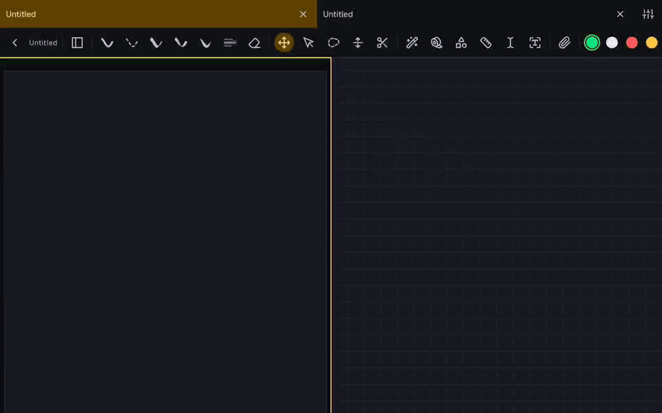

Split view currently repeats the toolbar in each document pane. This adds a shared-tools mode: one toolbar controls the active document, leaving more room for both pages.

**Demo.** Shared tools, mixed-interface selection and tools per pane, recorded on a Redmi Pad 2 (Android 16).

[Watch the full MP4 recording](https://github.com/wesleydanieell/xnotes-android/blob/4aebe055b225a7d03f704526d1465ce4e97d26c5/docs/pr-media/videos/shared-split-tools.mp4). The animated image is an 8 fps preview.

**Change.**
- Let users choose shared tools or tools per pane in Preferences and inside an open split.
- Share the matching interface for two notes or two canvases. For a mixed pair, let the user choose the note or canvas interface.
- Route commands to the active editor and disable format-specific controls when they are unavailable to that document.
- Preserve each document's selection and drawing surface when focus changes.

**Testing.** Debug and instrumentation APKs built successfully; `testDebugUnitTest` passed with 2,428 tests. On a Redmi Pad 2 (Android 16), three existing device tests passed: Undo targets the active note, Undo targets the active document in a mixed split, and shared/per-pane mode can be changed inside the note. The recording also exercises mixed-interface selection and per-pane tools.

Still a draft: the full docked/floating, edge, resize and rotation matrix has not been rerun.

AI tools assisted with implementation, documentation and validation.
