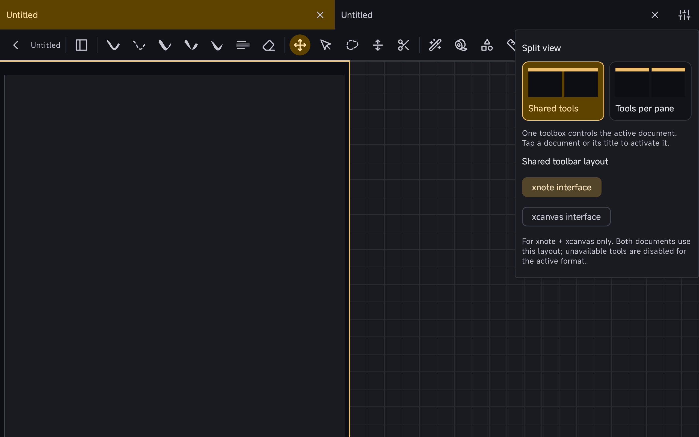
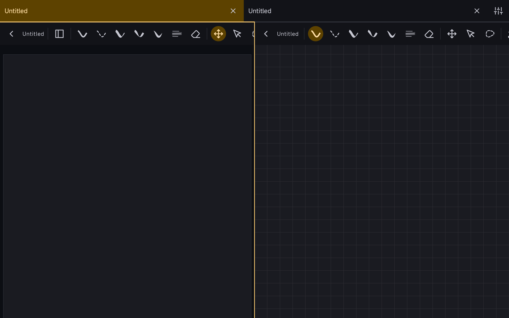

Two open documents can share one toolbar instead of duplicating tools in each pane. Commands follow the active editor. For a mixed note/canvas pair, users choose which interface both viewers use; format-specific controls are disabled when unavailable to the target document.

Preferences and the in-note controls let users switch between shared tools and tools per pane. This PR uses the existing native toolbar and split host, so it can be reviewed independently of document tabs and multi-toolbar customization.

### Validation

- Debug compilation and **2,428 JVM tests passed**, covering placement geometry and preference round trips/fallbacks.
- An isolated Android device suite is included for active-editor commands, first-stroke focus, selection retention, geometry, mixed interfaces and pane closing.
- ARM64 debug and instrumentation APKs built successfully. On Redmi Pad 2 (Android 16), the capture scenario and three existing device tests passed: note Undo routing, mixed note/canvas Undo routing, and in-note shared/per-pane switching. The exhaustive edge/rotation matrix has not been rerun.

### Screenshots

**One shared toolbar for a note and a canvas**

**In-note shared/per-pane and interface settings**

**Separate tools for each pane**

Unedited Redmi Pad 2 screenshots from this feature branch using blank documents in an isolated package. [Capture sources and results](https://github.com/wesleydanieell/xnotes-android/tree/14f9168132f4c8ecf4a31c658fc61d6def3df2e6/docs/pr-media).

### Scope

The newer community integration exposes the mixed-interface choice through document tabs. That adapter depends on other pending work and is deliberately excluded here. This independent implementation retains its own in-note settings entry.

Draft pending completion of the device test matrix. AI tools assisted with implementation, extraction, documentation and validation.
