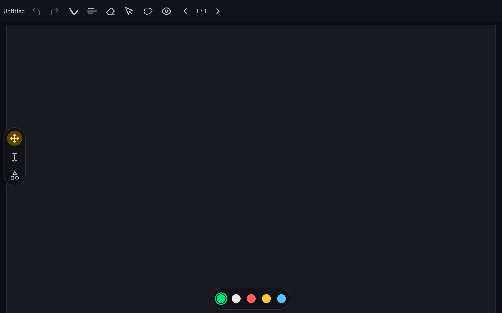
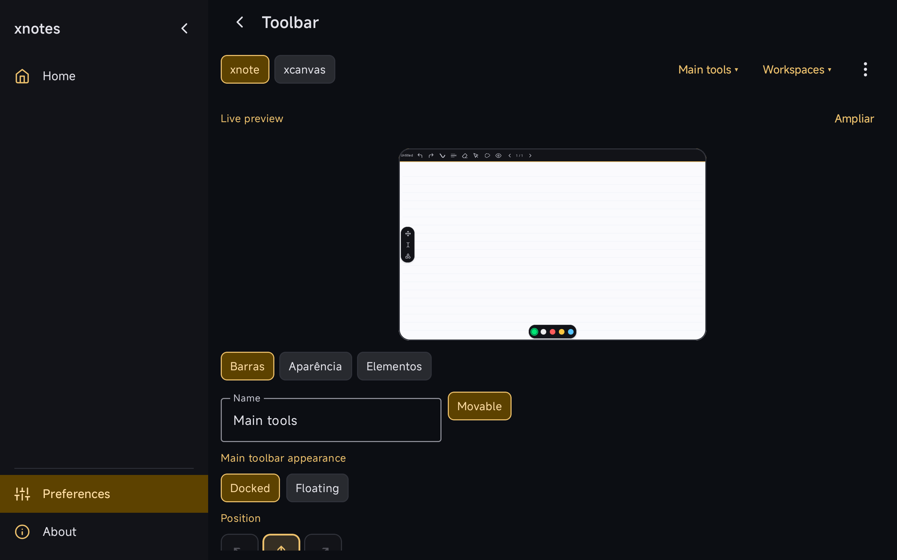
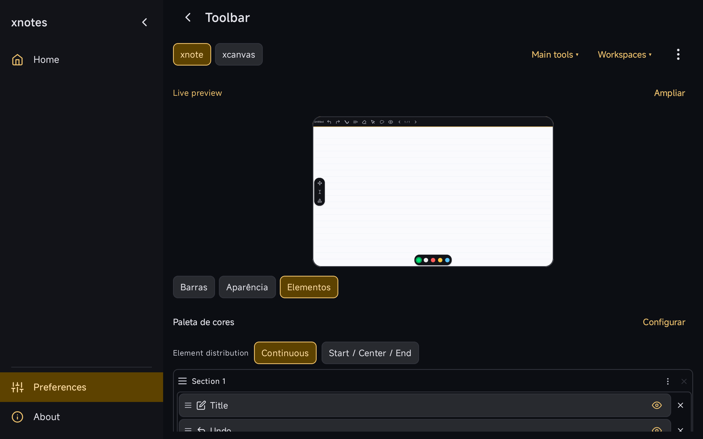

Users can configure multiple toolbars for paged notes and infinite canvases, then place each bar on a docked edge or a floating anchor. A dedicated editor keeps bar, appearance and element settings alongside a workspace preview.

- Add, duplicate, rename, move and remove bars; arrange sections, lanes and spacers.
- Configure geometry and retain independent note/canvas profiles, with optional profile sharing.
- Migrate existing single-toolbar settings and import/export named workspace presets.
- Move the former inline toolbar configuration out of general preferences into smaller UI components.

### Review structure

The implementation is split into reviewable commits: immutable workspace/dock model → persistence/migration → runtime → dedicated editor → import cleanup. These layers form one usable feature, so this PR includes the complete stack. Pen Group is proposed independently in #429. Document tabs and shared split-toolbars are separate contributions.

Review commits: [model](https://github.com/wesleydanieell/xnotes-android/commit/9ae8d7e2), [persistence](https://github.com/wesleydanieell/xnotes-android/commit/5eeb6fa3), [runtime](https://github.com/wesleydanieell/xnotes-android/commit/93c780bb), [editor](https://github.com/wesleydanieell/xnotes-android/commit/9c7f4dfb), [cleanup](https://github.com/wesleydanieell/xnotes-android/commit/c0e43cfd).

### Validation

- Debug Kotlin compilation and JVM tests passed; the extracted editor suite has **2,516 tests, zero failures**. The final import-only cleanup was separately compiled.
- ARM64 debug and instrumentation APKs built successfully. The Redmi Pad 2 (Android 16) capture scenario passed, opening the workspace, configurator and elements inspector.
- Existing layout migration, geometry, preset transfer, placement, reset and editor interaction tests are included.

### Screenshots

**Docked main toolbar with floating quick tools and an ink palette**

**Dedicated toolbar editor and workspace preview**

**Section and element editor**

Unedited Redmi Pad 2 screenshots from this feature branch using blank documents in an isolated package. [Capture sources and results](https://github.com/wesleydanieell/xnotes-android/tree/14f9168132f4c8ecf4a31c658fc61d6def3df2e6/docs/pr-media).

### Remaining review

Draft for review of the extracted implementation. Some configurator text still needs localization. The preview uses sample paper styling; theme parity with the actual note still needs review. Captures demonstrate the displayed configurations; they do not replace the complete device matrix for dragging, rotations, all edges and animation behavior.

AI tools assisted with implementation, extraction, documentation and validation.
