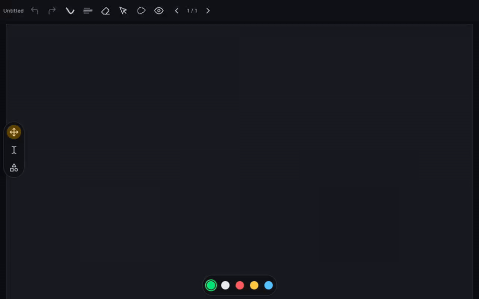

Toolbar configuration currently edits one layout per document type. Drawing tools, navigation and colors cannot be placed in separate, independently configured bars. This adds toolbar workspaces and a dedicated configuration screen with a live preview.

**Demo.** Workspace preview, element settings and docked/floating placement, recorded on a Redmi Pad 2 (Android 16).

[Watch the full MP4 recording](https://github.com/wesleydanieell/xnotes-android/blob/4aebe055b225a7d03f704526d1465ce4e97d26c5/docs/pr-media/videos/toolbar-workspaces.mp4). The animated image is an 8 fps preview.

**Change.**
- Add, duplicate, rename, move and remove bars, with docked and floating placement.
- Arrange elements into sections and lanes; configure spacing, size and spacers.
- Keep note/canvas profiles, optionally share a profile, and import/export named presets.
- Migrate existing single-bar settings to a primary bar.
- Move toolbar editing out of general Preferences into separate bar, appearance, element and preview components.

The commits separate the workspace model, persistence, runtime, editor and cleanup for review.

**Testing.** The JVM suite passed with 2,516 tests; the final import-only cleanup was separately compiled. Debug and instrumentation APKs built successfully. On a Redmi Pad 2 (Android 16), the device scenario opened the workspace, configurator and elements inspector. The recording also changes the primary bar from docked to floating through the configurator.

Still a draft: some UI text needs localization, preview paper styling needs theme-parity review, and the complete drag/edge/rotation matrix remains pending.

AI tools assisted with implementation, documentation and validation.
