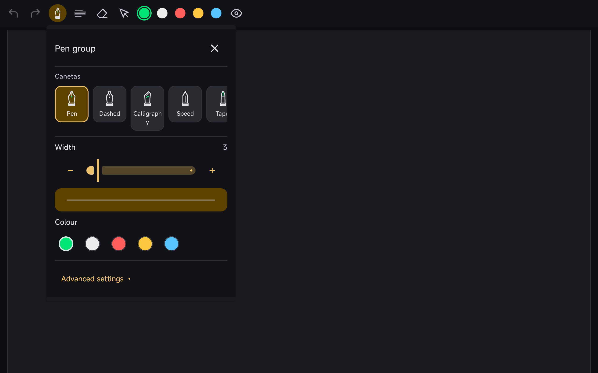
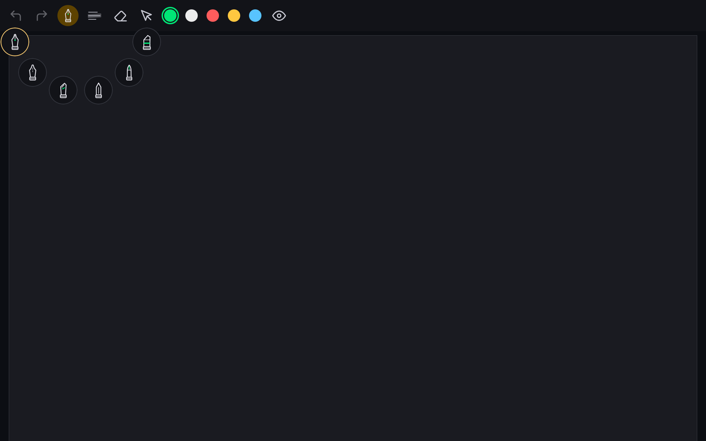

Add an optional Pen Group launcher to the existing note and canvas toolbars. A tap selects the remembered pen or opens its details; holding the launcher exposes a fan of pen choices.

The entry is hidden by default, preserving the existing visible layout. It uses the current tool configuration and ink callbacks and does not depend on multi-toolbar workspaces or the new configurator.

### Validation

- Debug compilation and **2,429 JVM tests passed**, including grouping and pen-fan gesture tests.
- ARM64 debug and instrumentation APKs built successfully. The Redmi Pad 2 (Android 16) capture scenario passed for opening details and the hold fan.

### Screenshots

**Optional Pen Group details**

**Pen fan opened by holding the launcher**

Unedited Redmi Pad 2 screenshots from this feature branch using blank documents in an isolated package. [Capture sources and results](https://github.com/wesleydanieell/xnotes-android/tree/14f9168132f4c8ecf4a31c658fc61d6def3df2e6/docs/pr-media).

Draft pending broader gesture/device review, particularly fan placement and cancellation on each toolbar edge. Long family labels also need wrapping/localization review. AI tools assisted with implementation, extraction, documentation and validation.
