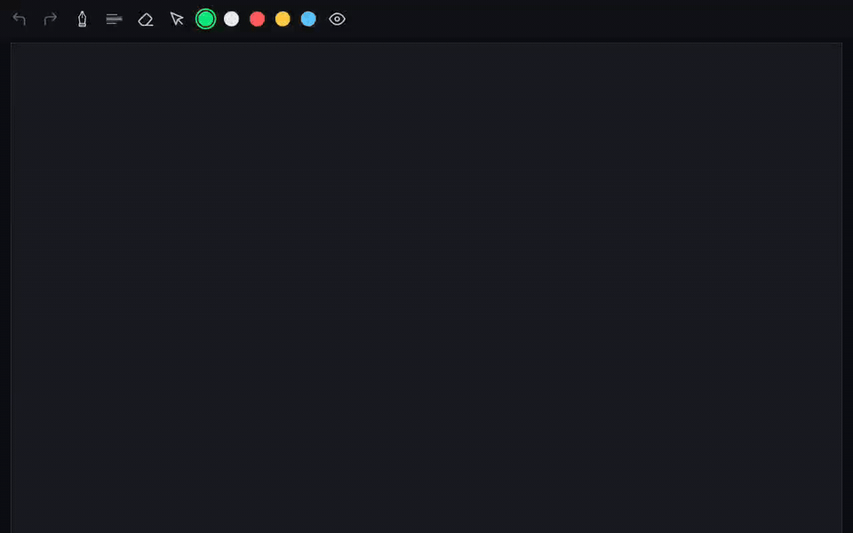

The toolbar gives each pen family its own button. An optional Pen Group puts those choices behind one launcher while keeping the selected pen's settings close at hand.

**Demo.** Pen details, family selection and the hold fan, recorded on a Redmi Pad 2 (Android 16).

[Watch the full MP4 recording](https://github.com/wesleydanieell/xnotes-android/blob/4aebe055b225a7d03f704526d1465ce4e97d26c5/docs/pr-media/videos/pen-group.mp4). The animated image is an 8 fps preview.

**Change.**
- A tap selects the remembered pen; tapping an already selected pen opens its details.
- Holding the launcher opens a fan for choosing another pen family.
- Reuse the existing pen configuration and ink controls in note and canvas toolbars.
- Keep the new entry hidden by default, so existing visible layouts are preserved.

**Testing.** Debug and instrumentation APKs built successfully. `testDebugUnitTest` passed with 2,429 tests, including group and fan-gesture tests. On a Redmi Pad 2 (Android 16), the device scenario opened the details and hold fan. The recording shows selecting a pen family and opening the fan.

Still a draft: fan placement/cancellation across every toolbar edge and long family-label wrapping/localization need further review.

AI tools assisted with implementation, documentation and validation.
