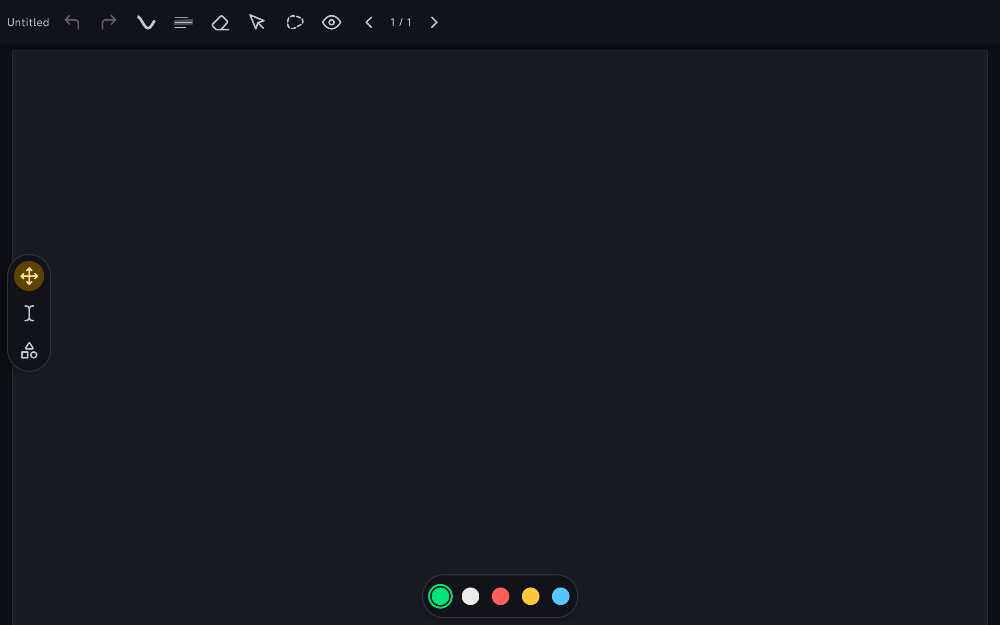
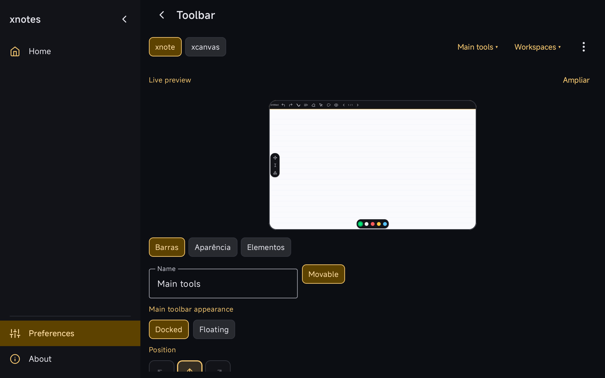
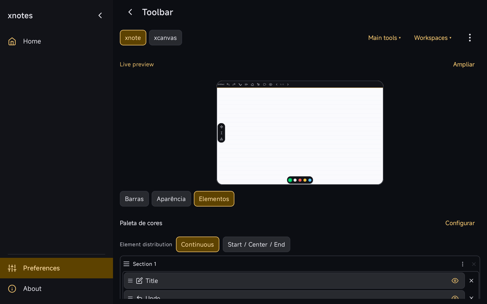
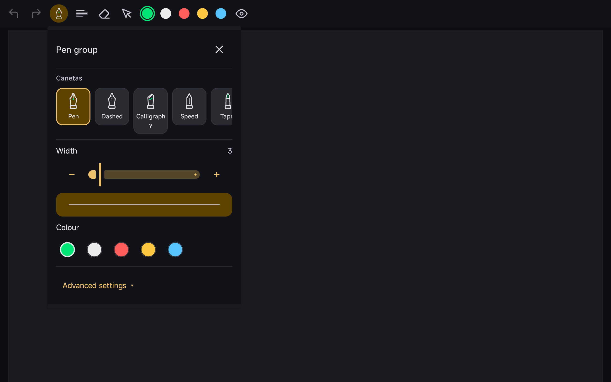
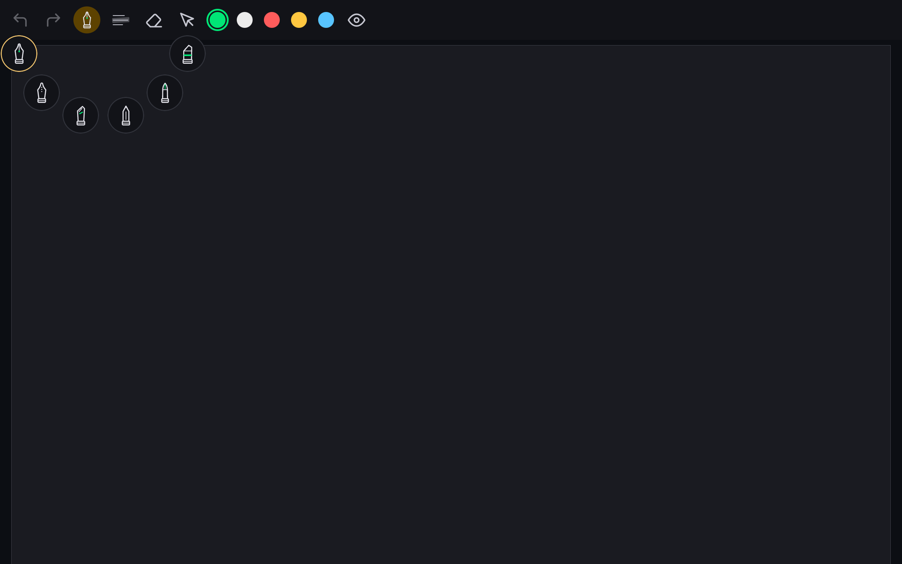
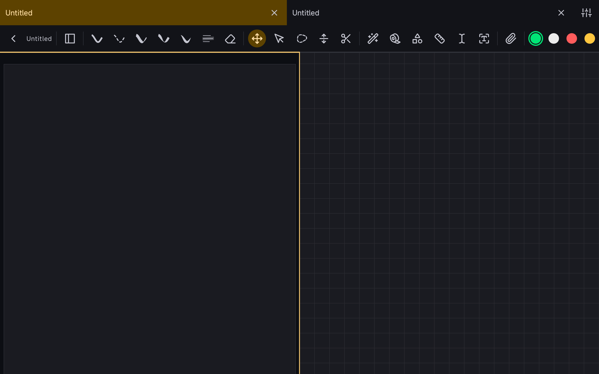
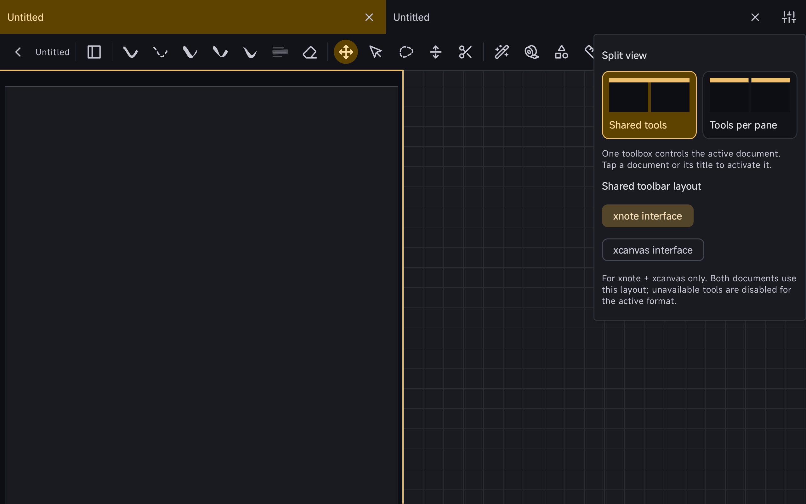
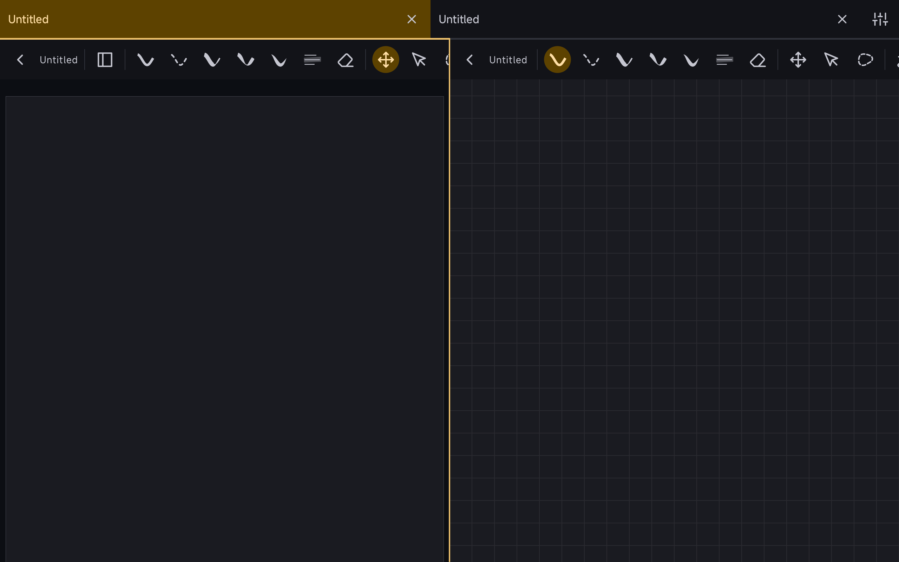

# XNotes PR screenshots — 2026-11-10

Real, unedited Redmi Pad 2 (Android 16) screenshots captured from the isolated feature builds listed in [manifest.json](manifest.json). Blank test documents contain no personal notes. The community packages were not used or changed.

This media-only branch hosts immutable image links for upstream PR descriptions, keeping screenshots and capture tooling out of the code PR diffs.

## Toolbar workspaces

`xnotes/pr/toolbar-customizer` at `c0e43cfd`.





## Optional Pen Group

`xnotes/pr/unified-pen` at `26d18773`.




## Shared split tools

`xnotes/pr/shared-split-toolbars` at `115571bb`. This native-toolbar contribution is independent of the newer tabs selector/community adapter.





## Validation and reproduction

The three ARM64 debug APKs and their capture instrumentation APKs built successfully. One capture scenario per feature passed. Three additional existing shared-toolbar device tests passed: note Undo targeting, mixed note/canvas Undo targeting, and switching shared/per-pane tools in the note. See `validation/` for result summaries.

The build configuration and source files are under `capture/`. From the corresponding feature worktree, with JDK 17 and the Android SDK configured, set `media` to this directory and run (example: toolbar):

```sh
./gradlew --max-workers=2 -Pandroid.injected.build.abi=arm64-v8a   -Pkotlin.incremental=false -Pkotlin.compiler.execution.strategy=in-process   -I "$media/capture/capture.gradle" -PreviewSuffix=.prtoolbar   -PreviewSources="$media/capture/toolbar"   :app:assembleDebug :app:assembleDebugAndroidTest
adb install -r -t app/build/intermediates/apk/debug/app-debug.apk
adb install -r -t app/build/intermediates/apk/androidTest/debug/app-debug-androidTest.apk
adb shell am instrument -w -e class com.xnotes.ui.ReviewCaptureTest   com.xnotes.prtoolbar.test/android.test.InstrumentationTestRunner
```

For Pen Group use source directory `pen`, suffix `.prpen` and package `com.xnotes.prpen`. For shared tools use `shared`, `.sharedsplit` and `com.xnotes.sharedsplit`. Screenshot files are written to the isolated app's external files directory. Do not substitute a community or personal app package when running fixtures.

These screenshots demonstrate selected configurations. The full rotation/edge/dragging matrix is still pending. Some extracted UI strings and long pen-family labels need localization/layout review. No generated mockups or images from the broader community integration are presented as screenshots of these PRs.
